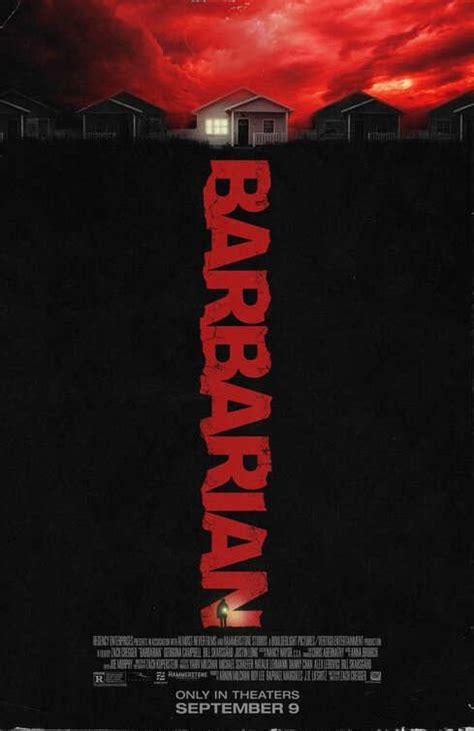

+++
title = "Barbarian (2022)"
date = "2026-10-21"
description = "I love a good misdirection"
taxonomies.tags = ["backlog", "movies"]
+++

Two things I liked about Barbarian:
1. You think it's one movie and takes a _HARD_ left turn.
2. It felt like a video game.

If you've seen it you understand (1) but (2) might need some explanation.

There's a scene where the main protagonist is searching for something, anything, and finds a clue, then tugs on that thread to find another things and another, etc.
At each step she's like "Nope nope nope" which felt _very_ video-gamey.
Ever single horror game I've played I find where I need to go, but there's a big monster or creepy hallway in the way so I need like... convince myself to do it even though I really don't want to.

Also Zach Cregger ended up doing a good Resident Evil movie so I think it's fair to assume he's a fan of games and video games have informed his filmmaking at least a little bit.