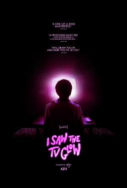

+++
title = "I Saw the TV Glow (2024)"
date = "2026-10-30"
description = "Immaculate vibes, intense atmosphere, lite on the horror"
taxonomies.tags = ["backlog", "movies"]
+++

I went into this movie pretty blind, not sure what to expect.
What I got was a slow, methodical, light horror-ish film about a few things:
* Transitioning, the pain of not doing so, and why it can feel scary before jumping in.
* Who can you trust? Your memories? Your senses? Are you who you think you are? That sort of thing.

The story is basically this:
1. A kid is enamored with a show similar to but not exactly Buffy the Vampire Slayer for teens.
2. He finds a slightly older kid who is _really_ into the show, they become friends.
3. Kid A basically watches the entire thing over the next few years.
4. Kid B eventually runs away.
6. A few years later A is living a dead-end life B turns up again.
  1. B tries to persuade A that they ARE the main characters from the show they watched as kids.
  2. B had to commit suicide to escape this prison and is trying to save A.
  3. A cannot commit and chooses instead to live a life where they suffer as a basic of existence.

I appreciated the metaphor of the film.
Obviously having never transitioned I understand in the abstract what goes into that decision, but I appreciate it making it feel so concrete both the fear of not being able to make the leap, but also the crushing weight of living a life trying to deny who you are.

I certainly wouldn't call it a _scary_ movie, but it was suspenseful and had me engaged with the material the whole way through.
If the rest of the movie seemed interesting but you "Don't watch horror" I think you should give it a try.

I am not a meaningful voice to contribute in any way to a conversation about this film -- surely none of this is New (TM).
I enjoyed the vibes, I appreciated the metaphor, I'm excited to watch more films by [Jane Schoenbrun](https://en.wikipedia.org/wiki/Jane_Schoenbrun).