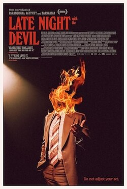

+++
title = "Late Night With the Devil (2023)"
date = "2026-10-31"
description = ""
taxonomies.tags = ["backlog", "movies"] 
+++

I love a good "Bottle Episode" movie.
All taking place on one set, one night, super tight story telling.

The premise, one night on a late-night tv show, gone horribly wrong for all the usual reasons (chasing fame, etc), really sold for me.
It means we watch the show basically in real time, the original tapes showing us what the audience saw that night, for roughly an hour (with some setup and conclusion to make it a full length movie).

The acting is solid, the special effects weren't flawless but given the budget I think they did a great job selling a surprising number of effects given the budget.

* Is it the best horror movie? Of course not.
* Is it, as according to Wikipedia, an independent postmodernist supernatural horror film?  I guess so... that feels like it's in reference to the analogue horror elements sprinkled throughout so if you want to put a fancy label on that go for it.
* Is it a solid horror movie, and a solid way to spend your Halloween while you fold laundry? Yes. Of course.

Mostly I'm realizing I'm a fan of [David Dastmalchian](https://en.wikipedia.org/wiki/David_Dastmalchian)