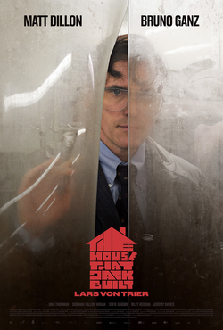

+++
title = "The House That Jack Built (2018)"
date = "2026-10-27"
description = "A truly rotten movie... and that is a complement."
taxonomies.tags = ["backlog", "movies"]
+++

In the spirit of Halloween, I've been watching horror movies.
I picked this horror movie from my "to watch" list sort of at random, sort of based on the post.

I went in with no expectations and was surprised to find a truly rotten movie, which was a pleasant surprise.

I'm not sure what else to add.
I really like Rotten media, as a subgenre of Horror, but I haven't figured out why I like it more than other horror.

Yes the main character is a piece of shit, yes he kills people, don't worry he gets what he deserves.

I especially like the visuals at the end where Jack... let's say he goes on a journey.
It's a very painterly scene.